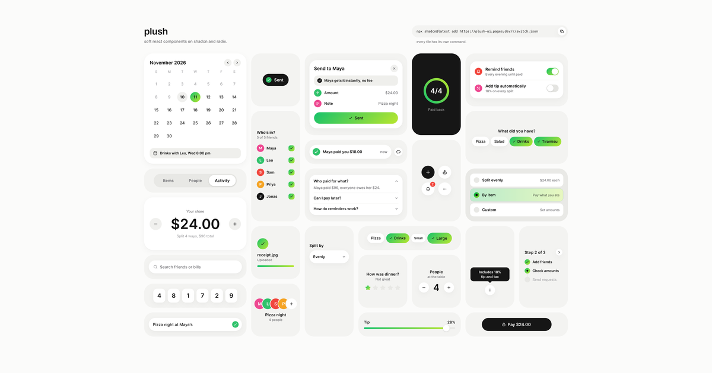

# plush

Soft React components on shadcn and Radix, installed from a shadcn registry.

[](https://plush-ui.pages.dev)

## Add a component

```sh
npx shadcn@latest add https://plush-ui.pages.dev/r/switch.json
```

This copies the component into your project and adds the plush tokens to your CSS. From then on the code is yours.

You need a project with React, Tailwind CSS v4 and shadcn. If shadcn is not set up yet, run `npx shadcn@latest init` first.

## Components

accordion, avatar, badge, button, calendar, checkbox, counter, dialog, input, input-otp, progress, progress-ring, radio-group, rating, select, slider, sonner, steps, switch, tabs, toggle, toggle-group, tooltip

Put any of these names in place of `switch` in the command above.

## Run locally

```sh
pnpm install
pnpm dev
```

`pnpm build` writes the registry and the static site to `out/`.

## License

MIT, see [LICENSE](LICENSE). The font Open Runde is under the SIL Open Font License (`licenses/open-runde-OFL.txt`), the Hugeicons icons under MIT.
